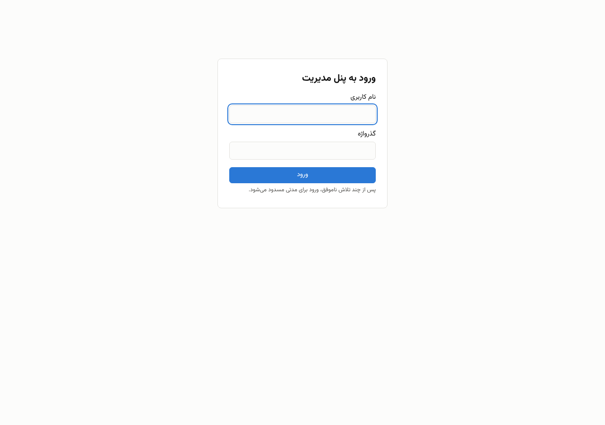
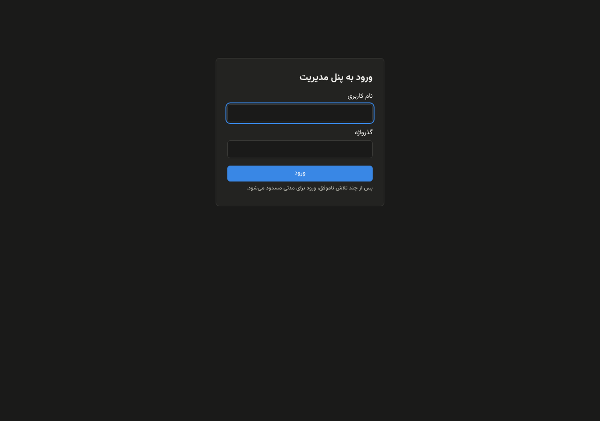
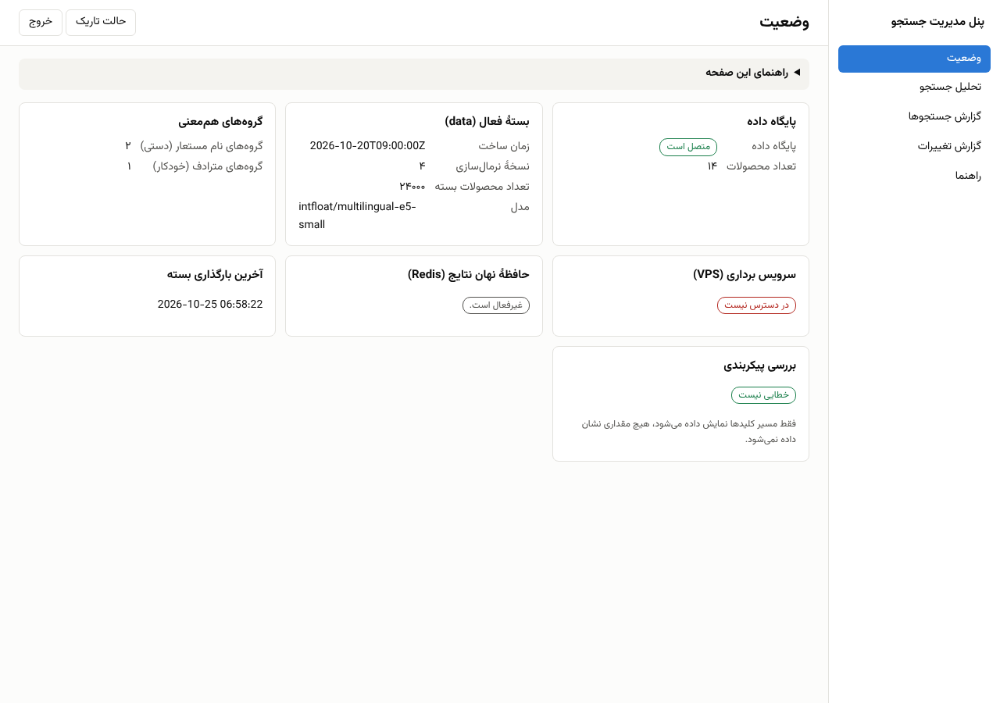
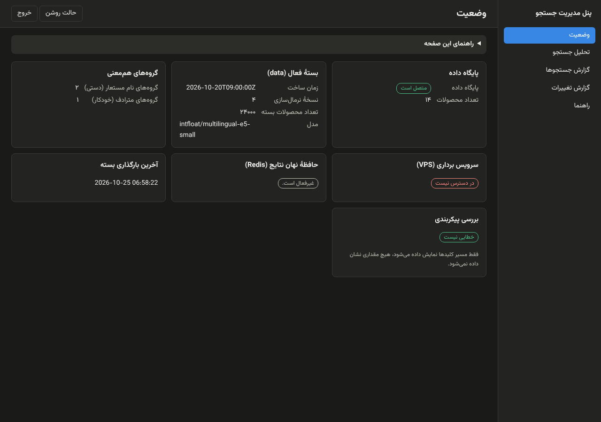
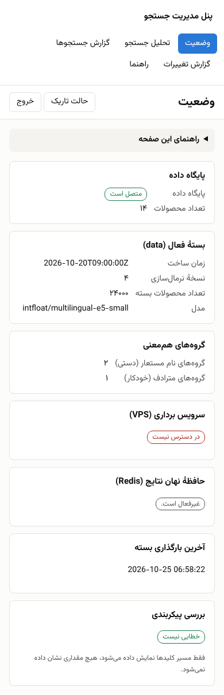
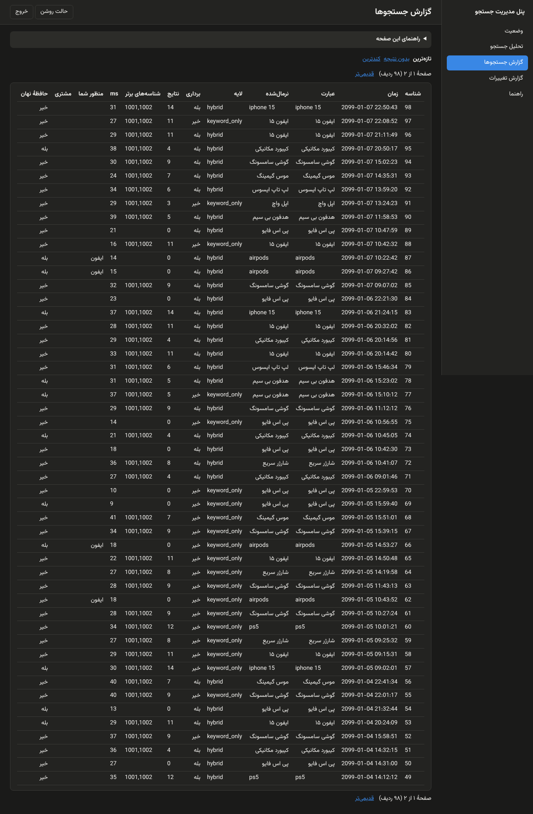
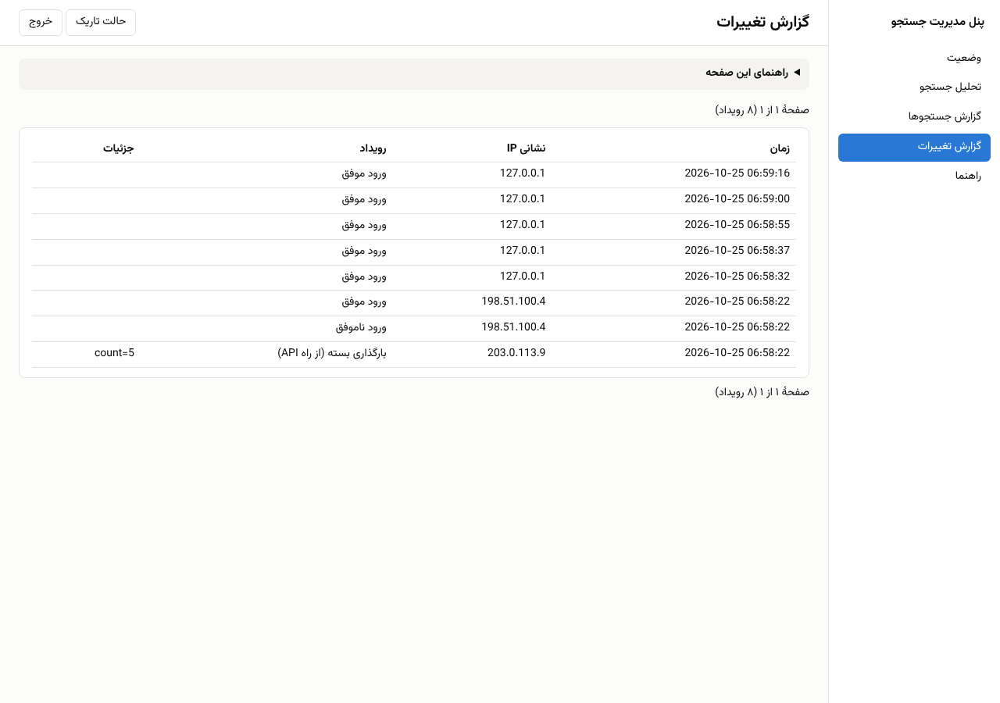
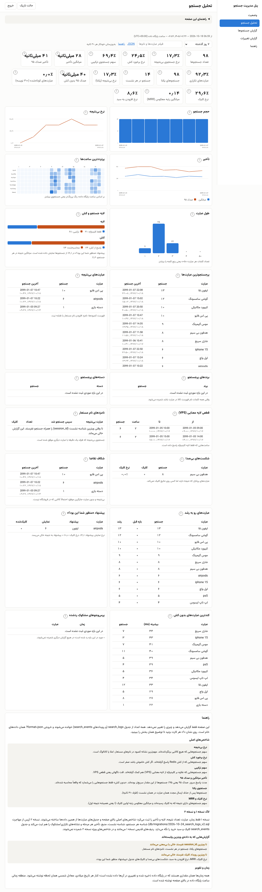

# Admin panel

One Persian, right-to-left panel on the cPanel service, `https://<site>/<service>/admin.php`, replacing the
token-protected browser pages. It is plain PHP in `server/public/admin.php` plus a few small classes in
`server/src/`; no framework, no Composer runtime package, no request to any other host.

Built in milestones (M39 to M42). **M39 (this document so far)**: login, shell, status page, audit log, and the
analytics and logs pages behind the login. Operations (reload, rollback, cache flush, VPS reload), the alias
manager and the synonyms viewer follow in M40 and M41.

## Setup

1. Apply `db/migrations/2026-10-25_admin_audit.sql` (idempotent; `db/schema.sql` has it for new installs;
   `2026-10-25_admin_audit.down.sql` rolls it back).
2. `php server/tools/admin-password.php` prompts for a password (at least 12 characters, typing hidden) and prints a
   `password_hash()` value. Put it in `config.php`:

   ```php
   'admin' => ['username' => 'owner', 'password_hash' => '$2y$10$...'],  // single quotes: the hash has `$`
   ```

   A plaintext password is never accepted. Without `username` and `password_hash` the panel answers **503**.
3. `php server/tools/config-check.php` reports the admin config: a missing config is a WARN, a half-set one or a
   `password_hash` that is not a hash is an ERROR (key paths only, never values). The same report is on the status
   page and in `/health`.

All keys (`allowed_ips`, timeouts, throttling, retention, proxy settings) are in
[CONFIGURATION.md](CONFIGURATION.md#admin-panel-section-m39).

## Security model

| Rule | How |
| --- | --- |
| HTTPS only | A plain-HTTP request is refused with 403 before any form or cookie. TLS ended at a proxy: set `admin.trust_forwarded_proto` so `X-Forwarded-Proto: https` counts. |
| Address list | `admin.allowed_ips` (IPs, IPv4 / IPv6 CIDR). Others get 403 and never see the form. Behind a proxy set `admin.ip_header`, or every visitor looks like the proxy. |
| Own session | Name `search_admin`; cookie `Secure`, `HttpOnly`, `SameSite=Strict`, scoped to the folder the panel is served from; strict mode; the id is regenerated on login. |
| Lifetimes | Idle timeout (30 min) and absolute lifetime (8 h). The analytics page's background `?format=json` polls do **not** refresh the idle clock, so an unattended dashboard still logs out. |
| Login check | `hash_equals` for the username and `password_verify` for the password, both always evaluated, one generic error message. |
| Throttling | At most 5 failed logins per address and 50 globally per 15 minutes (counted from `admin_audit`; the right password is refused while throttled, with 429). |
| CSRF | A per-session token on the login form and on every POST (`csrf` field or `X-CSRF-Token`). Logout is POST only. |
| Headers | `Cache-Control: no-store`, `X-Robots-Tag: noindex`, `X-Frame-Options: DENY`, `Referrer-Policy: no-referrer`, a CSP with a per-response nonce (`default-src 'none'`, self-hosted fonts, `connect-src 'self'`), no third-party request. |
| Audit | `admin_audit` (time, address, action, short detail) for login success and failure, throttled attempts, logout and `POST /reload`; M40 and M41 add every write action. The attempted password is never stored. Rows older than `admin.audit_retention_days` (180) are deleted on write (`DELETE ... LIMIT`). |

If `admin_audit` does not exist the panel answers 503 with the migration hint, rather than letting anyone in
unthrottled.

## Pages (M39)

| `?p=` | What it is |
| --- | --- |
| `status` | Read-only: database and product count, the live bundle's `meta.json` (built at, normalization version, counts), alias and synonym group counts, VPS `/health`, Redis ping and the number of keys under `redis.prefix`, the config doctor result, last reload time. The VPS and Redis probes time out at `admin.probe_timeout_ms` (1 s) and show "unreachable". |
| `analytics` | The M35/M38 dashboard. `?p=analytics&format=json` is the same JSON as before (byte-identical, covered by `AnalyticsJsonCompatTest`), now needing a session: 401 `{"error":"unauthorized"}` without one. |
| `logs` | Recent / zero-result / slowest `search_logs` rows, paginated. |
| `audit` | The audit trail. |
| `help` | The full guide. Every page also has a collapsible help box: what it is for, how to use it, the effect on live search, when a change takes effect and the risks. |

`analytics.php` and `logs.php` remain only as redirects to the panel (the token is gone; `logs.token` is
deprecated). The "last reload" figure is the newest `reload_api` audit row, written by `POST /reload` itself (the
`X-Reload-Token` path used by scripts is unchanged).

## Screenshots

Checked in Chromium in both themes (system colour scheme and the stored toggle), RTL, no console error and no
request outside the origin (see the PR report).

| Login (light / dark) | Status (light / dark) | Status, mobile width | Logs, Audit, Analytics |
| --- | --- | --- | --- |
|   |   |  |    |

## Where things live

| File | Role |
| --- | --- |
| `public/admin.php` | the single entry; routing, login flow, headers |
| `src/AdminAuth.php` | session, throttling, CSRF, HTTPS and address rules |
| `src/Audit.php` | the audit table |
| `src/AdminStatus.php` | the status data and its probes |
| `src/AdminPage.php`, `AdminPage.css`, `AdminPage.js` | shell: side navigation, theme toggle, confirm dialogs |
| `src/AdminViews.php` | page bodies |
| `src/AdminStrings.php` | **every Persian string and help text**; edit wording here only |

Theme: follows the system until the toggle is used; the choice is stored in `localStorage` (`admin-theme`, guarded
by try/catch) and applied before first paint, so there is no flash of the wrong theme.

## Not verified here

LiteSpeed / LVE behaviour, the real host's session handling and file permissions, and the behaviour behind the
production proxy (client address, `X-Forwarded-Proto`). Check them with [DEPLOY.md](DEPLOY.md#upgrading-to-m39).
