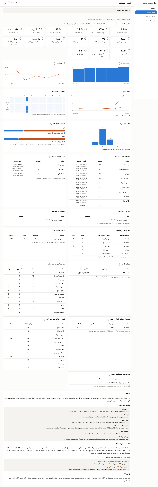
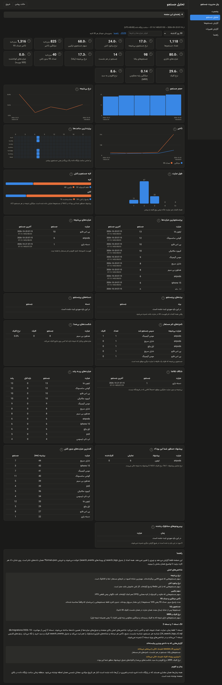
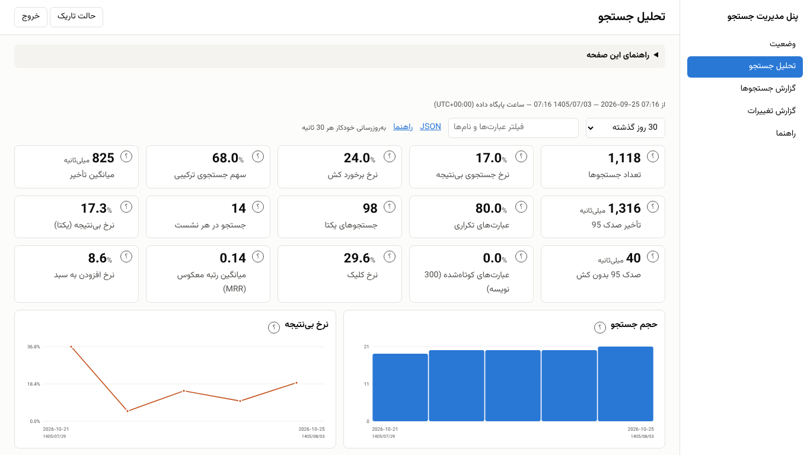
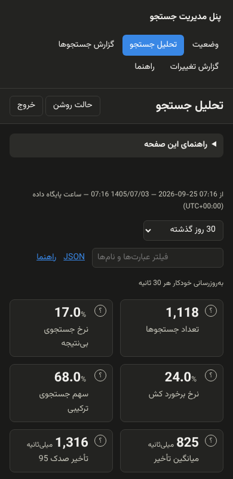
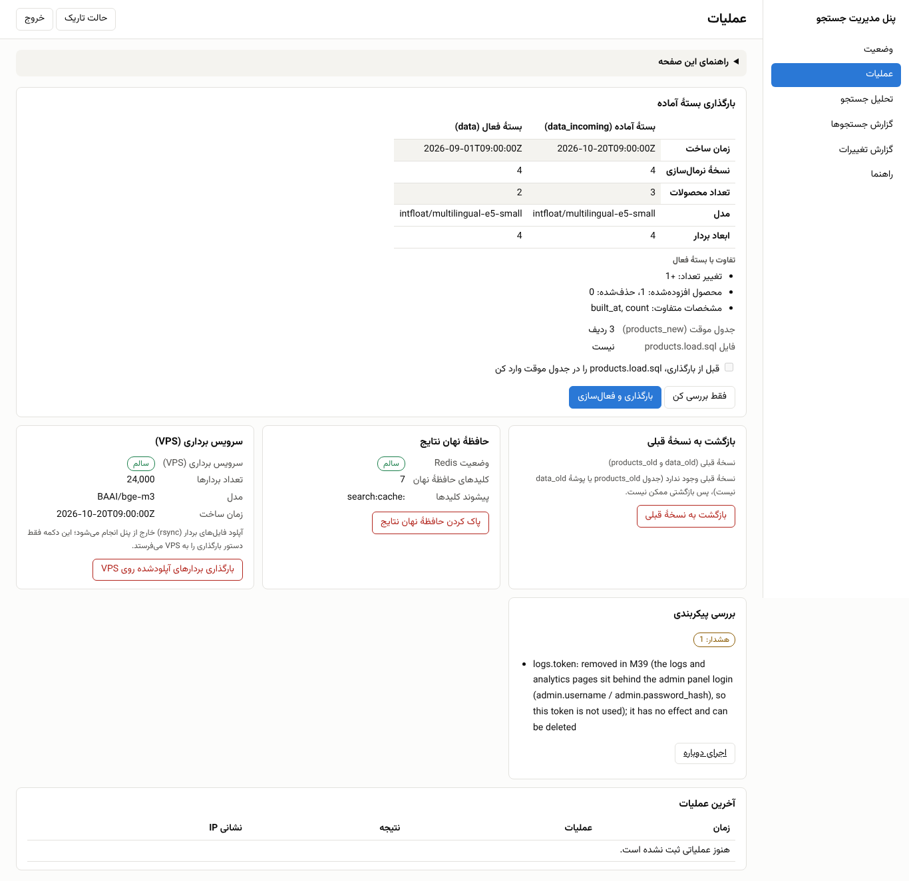
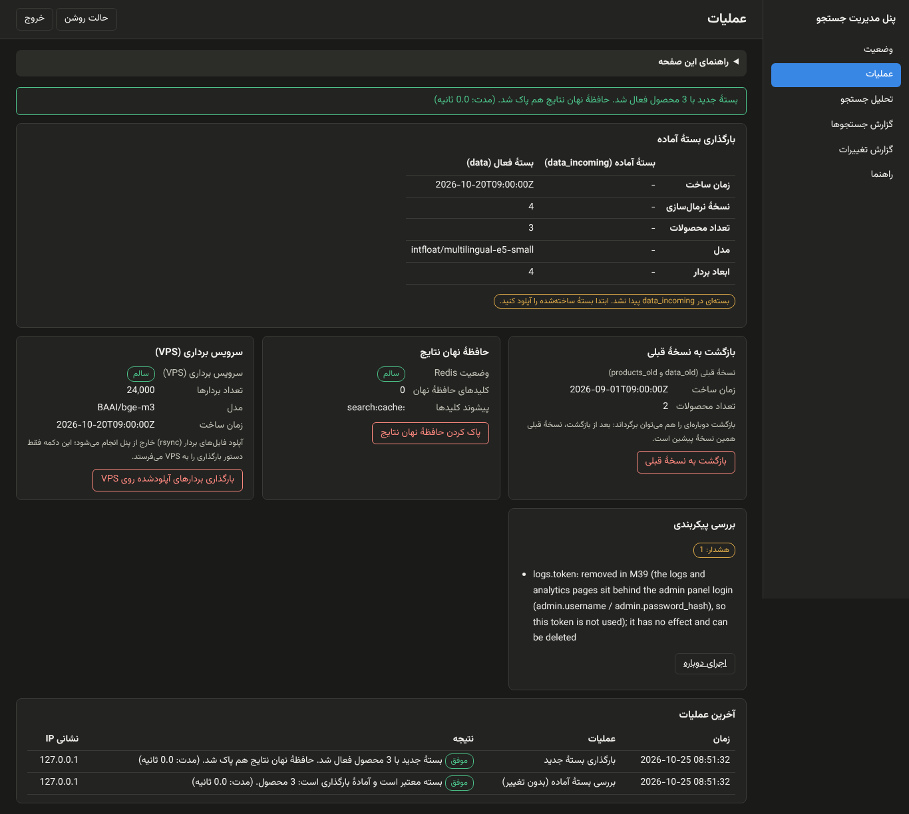
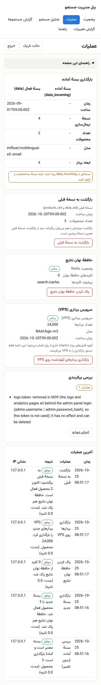
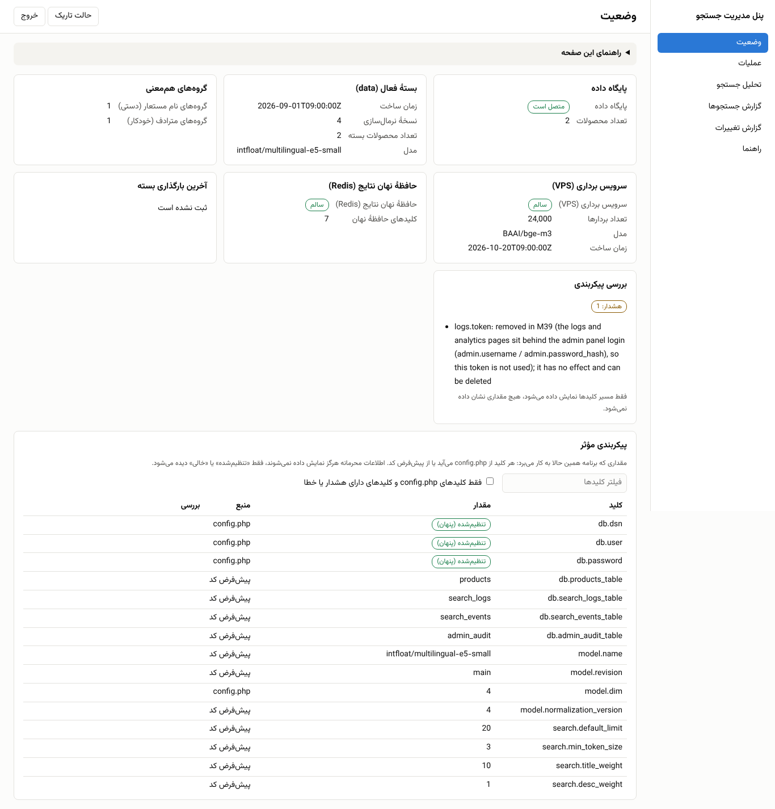
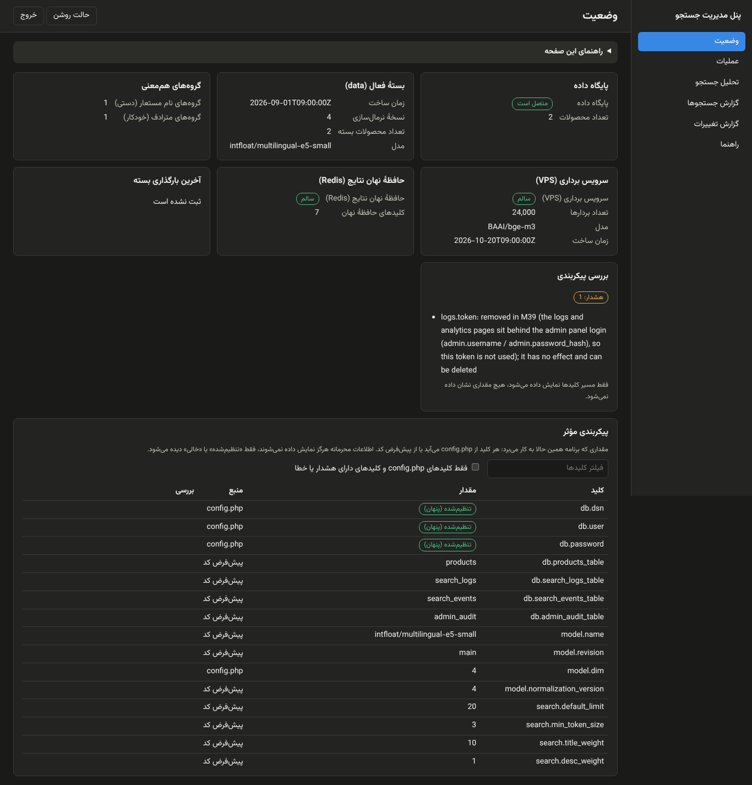

# Admin panel

One Persian, right-to-left panel on the cPanel service, `https://<site>/<service>/admin.php`, replacing the
token-protected browser pages. It is plain PHP in `server/public/admin.php` plus a few small classes in
`server/src/`; no framework, no Composer runtime package, no request to any other host.

Built in milestones (M39 to M42). **M39**: login, shell, status page, audit log, and the analytics and logs pages behind
the login. **M40**: the operations page (reload, rollback, cache flush, VPS reload), the effective-configuration table
and the config upgrade safety net. The alias manager and the synonyms viewer follow in M41.

## Setup

1. Apply `db/migrations/2026-10-25_admin_audit.sql` (idempotent; `db/schema.sql` has it for new installs;
   `2026-10-25_admin_audit.down.sql` rolls it back).
2. `php server/tools/admin-password.php` prompts for a password (at least 12 characters, typing hidden) and prints a
   `password_hash()` value. Put it in `config.php`:

   ```php
   'admin' => ['username' => 'owner', 'password_hash' => '$2y$10$...'],  // single quotes: the hash has `$`
   ```

   A plaintext password is never accepted. Without `username` and `password_hash` the panel answers **503**.
3. `php server/tools/config-check.php` reports the admin config: a missing config is a WARN, a half-set one or a
   `password_hash` that is not a hash is an ERROR (key paths only, never values). The same report is on the status
   page and in `/health`.

All keys (`allowed_ips`, timeouts, throttling, retention, proxy settings) are in
[CONFIGURATION.md](CONFIGURATION.md#admin-panel-section-m39).

## Security model

| Rule | How |
| --- | --- |
| HTTPS only | A plain-HTTP request is refused with 403 before any form or cookie. TLS ended at a proxy: set `admin.trust_forwarded_proto` so `X-Forwarded-Proto: https` counts. |
| Address list | `admin.allowed_ips` (IPs, IPv4 / IPv6 CIDR). Others get 403 and never see the form. The address is the one described under [Client address](#client-address). |
| Own session | Name `search_admin`; cookie `Secure`, `HttpOnly`, `SameSite=Strict`, scoped to the folder the panel is served from; strict mode; the id is regenerated on login. |
| Lifetimes | Idle timeout (30 min) and absolute lifetime (8 h). The analytics page's background `?format=json` polls do **not** refresh the idle clock, so an unattended dashboard still logs out. |
| Login check | `hash_equals` for the username and `password_verify` for the password, both always evaluated, one generic error message. |
| Throttling | At most 5 failed logins per address and 50 globally per 15 minutes (counted from `admin_audit`; the right password is refused while throttled, with 429). |
| CSRF | A per-session token on the login form and on every POST (`csrf` field or `X-CSRF-Token`). Logout is POST only. |
| Headers | `Cache-Control: no-store`, `X-Robots-Tag: noindex`, `X-Frame-Options: DENY`, `Referrer-Policy: no-referrer`, a CSP with a per-response nonce (`default-src 'none'`, self-hosted fonts, `connect-src 'self'`), no third-party request. |
| Audit | `admin_audit` (time, address, action, short detail) for login success and failure, throttled attempts, logout and `POST /reload`; M40 and M41 add every write action. The attempted password is never stored. Rows older than `admin.audit_retention_days` (180) are deleted on write (`DELETE ... LIMIT`). |

If `admin_audit` does not exist the panel answers 503 with the migration hint, rather than letting anyone in
unthrottled.

### Client address

Everything that depends on who is calling (the login throttle, `allowed_ips`, the audit log) uses **`REMOTE_ADDR`
only**. `X-Forwarded-For` is a request header any visitor can set, so it is **not** trusted by default: rotating it
cannot reset a throttle counter or satisfy `allowed_ips` (both covered by tests).

If the panel is served through a reverse proxy or CDN, `REMOTE_ADDR` is the proxy's address and all visitors would share
one throttle counter. Then list the proxy in the optional **`admin.trusted_proxies`** (comma separated IPs and
IPv4 / IPv6 CIDR ranges). Only when `REMOTE_ADDR` is in that list is `X-Forwarded-For` read, **from the right**,
skipping entries that are themselves trusted proxies; the first other address is the client. A malformed entry or an
empty header falls back to `REMOTE_ADDR`. Do not list a proxy that does not overwrite or append to the header. On
plain cPanel hosting (no proxy in front), leave it empty.

## Pages (M39)

| `?p=` | What it is |
| --- | --- |
| `status` | Read-only: database and product count, the live bundle's `meta.json` (built at, normalization version, counts), alias and synonym group counts, VPS `/health`, Redis ping and the number of keys under `redis.prefix`, the config doctor result, last reload time. The VPS and Redis probes time out at `admin.probe_timeout_ms` (1 s) and show "unreachable". |
| `ops` | The operations page (M40), below. |
| `aliases` | The alias manager (M41), below. |
| `synonyms` | Read-only `synonyms.json`; "which groups hold term X" across alias and synonym groups with the merged result; "copy to aliases". Hand edits of `synonyms.json` are lost on the next build. |
| `tester` | A search without a log row and without the result cache: tier, did-you-mean, the top 10 titles with match type. |
| `analytics` | The M35/M38 dashboard. `?p=analytics&format=json` is the same JSON as before (byte-identical, covered by `AnalyticsJsonCompatTest`), now needing a session: 401 `{"error":"unauthorized"}` without one. |
| `logs` | Recent / zero-result / slowest `search_logs` rows, paginated. |
| `audit` | The audit trail. |
| `help` | The full guide. Every page also has a collapsible help box: what it is for, how to use it, the effect on live search, when a change takes effect and the risks. |

`analytics.php` and `logs.php` remain only as redirects to the panel (the token is gone; `logs.token` is
deprecated). The "last reload" figure is the newest `reload_api` audit row, written by `POST /reload` itself (the
`X-Reload-Token` path used by scripts is unchanged).

## Screenshots

Checked in Chromium in both themes (system colour scheme and the stored toggle), RTL, no console error and no
request outside the origin (see the PR report).

| Login (light / dark) | Status (light / dark) |
| --- | --- |
|   |   |

| Analytics, desktop (light / dark) | Analytics at 1366 px | Analytics, mobile |
| --- | --- | --- |
|   |  |  |

| Operations (light) | After "load and activate" (dark) | Operations, mobile |
| --- | --- | --- |
|  |  |  |

| Effective configuration (light) | Effective configuration (dark) |
| --- | --- |
|  |  |

| Logs | Audit trail |
| --- | --- |
|  |  |

## Operations page (M40)

`?p=ops` does what used to take a terminal and the reload token. Every action is a POST with the CSRF token, asks for
confirmation first (the dangerous ones), writes one `admin_audit` row and shows a result message in Persian. There is
no upload of `release.zip` or any code, and no `FLUSHALL`.

| Card | What it does | Takes effect |
| --- | --- | --- |
| **Reload the staged bundle** | Shows `data_incoming/` next to the live `data/`: build time, normalization version, count, the count change, how many product ids were added / removed (staged `products_new` against the live `products` table, once the staging table is loaded), the staging table and `products.load.sql`. **Validate only** runs every check of a reload and changes nothing; **load and activate** is the reload itself (optionally loading `products.load.sql` into `products_new` first, the equivalent of `reload.php?load=1`). | at once; the previous version stays as `products_old` + `data_old` |
| **Return to the previous version** | Swaps `products` / `products_old` and `data` / `data_old`. Disabled when either is missing. Refused when the previous bundle's model, dim or normalization version does not match the running code. A second press goes back. | at once |
| **Result cache** | Shows the Redis state and how many keys sit under `redis.prefix`; **clear** deletes those keys only (`SCAN` + `DEL`, 5 s timeout), never `FLUSHDB` / `FLUSHALL`, so other data on the same Redis is safe. | at once |
| **VPS** | Shows `/health` (count, model, built at) and **load the uploaded vectors** calls the VPS `POST /reload` with `vps.token` and `vps.reload_timeout_ms` (60 s). The `rsync` of the vector files stays outside the panel. | when the VPS finishes its own check |
| **Config doctor** | Runs the doctor on `config.php` and lists the key paths (never values). | - |
| **Latest operations** | The last 8 operations with their result; this is also where the outcome is when the browser was closed. | - |

The reload and the rollback are `App\Reload`, the same class `POST /reload` (the `X-Reload-Token` path for scripts) uses:
the panel copies none of its logic. They share one non-blocking file lock, `server/reload.lock`: a second reload, rollback
or validation while one runs is refused with "busy" (`409 {"error":"reload_busy"}` on the token endpoint), so a double
click or two tabs can never overlap. The server side of an action calls `ignore_user_abort(true)` and `set_time_limit(0)`
and releases the session lock before it starts; it runs to the end if the browser disconnects, and the page counts the
elapsed seconds while it waits. The result is stored in the audit row (`{"ok":true,"count":24000,"s":12.3}`) and shown
after the redirect, so a closed tab loses nothing. `server/` must be writable by the web user (the lock file, the
directory swaps).

## Effective configuration and upgrades (M40)

The status page ends with a table of **every config key**: the value the app uses, the **source** (`config.php` or the
code default) and the doctor's notes next to the keys they concern (a filter box and an "only what config.php sets or
the doctor flagged" switch). Credentials (`db.dsn`, `db.user`, `db.password`, every `*.token`, `redis.auth`,
`admin.password_hash`) show only "set" or "empty", and so do keys the schema does not know (a secret typed under a wrong
name must not leak). Nothing here is cached: it is what the next request will use.

`App\Config::deprecated()` maps old keys to what replaced them. A **renamed** key keeps working for two releases (its
value feeds the new key unless that is set too) and the doctor / status page warn with the new name; a **removed** key
is ignored and the warning says why and that the line can be deleted. Every config change of a milestone is listed in
[CHANGELOG.md](CHANGELOG.md).

## Alias manager (M41)

The list is `server/storage/aliases.json` (`paths.storage`). Tabs: **groups** (search, add, edit, delete a group; each
term shows its normalized form and the merged group when overlapping groups are joined; "count" computes the products
one term matches, on demand, per group; "test" opens the tester), **backups** (every save or restore keeps the previous
file, newest `admin.alias_backups`; diff against the current file; one-click restore), **advanced** (the whole file as
JSON with the same checks, plus a download).

- *Errors block a save*: not a list of lists of strings, an empty term (or one that normalizes to nothing), a group with
  fewer than 2 distinct normalized terms, duplicates after normalization, a term longer than `admin.alias_max_term_chars`.
- *Warnings need a confirm, only for groups you changed*: the term is in another group (the merged group is shown),
  shorter than 3 characters, matches more than `admin.alias_warn_matches` products, or is in `search.suggest_blocklist`.
- A save sends the file's version hash with the form; if the file changed meanwhile it is refused ("stale") and nothing
  is overwritten. Saves are audited (`alias_save`, `alias_restore`: counts and the first changed terms, never the file).
- Live at once: the next search reads the file; the result-cache key includes its version.

## Numbers and dates

Every number the panel prints uses Latin digits, a comma for thousands and a dot for decimals: `1,118`, `11.7%`,
`316 ms`. Jalali dates use the Latin numbering system too (`1405/08/03`). Server-rendered pages print the stored Gregorian text
with the Jalali date beside it through `AdminDate` (plain arithmetic, no ext-intl); the dashboard formats in the browser
(`fa-IR-u-ca-persian-nu-latn`). Persian words and labels stay Persian, and so do the shoppers' own query texts, which
are shown exactly as typed. The server side formats through `AdminViews::num()`, the dashboard script through the one
`fmt` helper in `AnalyticsPage.js` (a test fails if a number or date is formatted anywhere else). The JSON output
carries raw numbers and is unchanged.

In the dashboard's headline cards the "?" button owns a fixed corner (the card's start side is padded for it), the
value never wraps and its unit (`میلی‌ثانیه`, `%`) is drawn smaller and muted after the number. The cards are a CSS grid
(`repeat(auto-fill, minmax(...))`): all cards of a row have the same width and height, and the last row stays at the
start with the same card size.

## Where things live

| File | Role |
| --- | --- |
| `public/admin.php` | the single entry; routing, login flow, headers |
| `src/AdminAuth.php` | session, throttling, CSRF, HTTPS and address rules |
| `src/Audit.php` | the audit table |
| `src/AdminStatus.php` | the status data and its probes |
| `src/AdminPage.php`, `AdminPage.css`, `AdminPage.js` | shell: side navigation, theme toggle, confirm dialogs |
| `src/AdminViews.php` | page bodies |
| `src/AdminStrings.php` | **every Persian string and help text**; edit wording here only |

Theme: follows the system until the toggle is used; the choice is stored in `localStorage` (`admin-theme`, guarded
by try/catch) and applied before first paint, so there is no flash of the wrong theme.

## Not verified here

LiteSpeed / LVE behaviour, the real host's session handling and file permissions, and the behaviour behind the
production proxy (client address, `X-Forwarded-Proto`). Check them with [DEPLOY.md](DEPLOY.md#upgrading-to-m39).
